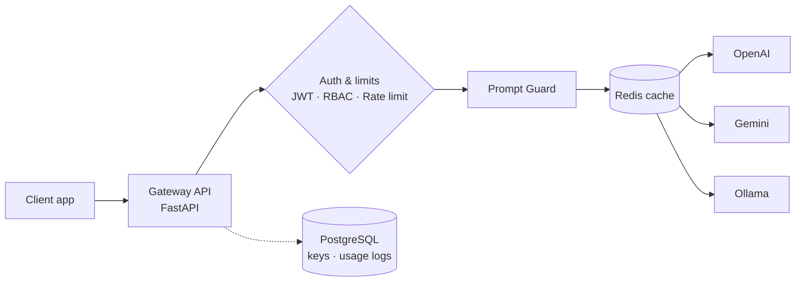

<h1 align="center">Billy · Tran Anh Tu</h1>

  Building and operating AI systems, from the API layer to the cluster. 
  IT undergraduate at UEH · Ho Chi Minh City, Vietnam 🇻🇳

  
  
  
  
  
  
  
  
  
  
   
  
  
  
  
  
  
  
  
  
  

  <a href="https://myportfolio-billy.vercel.app">Portfolio</a> ·
  <a href="https://www.linkedin.com/in/billytran201/">LinkedIn</a> ·
  <a href="mailto:trananhtu21012000@gmail.com">Email</a> ·
  <a href="https://orcid.org/0009-0009-5494-7877">ORCID</a>

---

## 👋 About me

I'm an IT student passionate about solving practical problems at the intersection of technology, data, and security. I'm most curious about the unglamorous side of AI: keeping it **reliable, secure, and affordable to operate**.

I use AI every day to move faster and understand problems better. My goal is to grow into an engineer who can **both build and operate AI well**.

- 🎓 B.Sc. Information Technology at **UEH**, GPA **3.39 / 4.0**, Academic Encouragement Scholarship
- 🔭 Interested in **DevOps, backend engineering, and AI operations**
- 🔎 Currently looking for an **internship** (DevOps / AI Ops / Software Engineering)

---

## 🚀 Featured project: SecureAI Gateway

> A secure gateway that sits between your apps and LLM providers, so API keys, cost, and abuse are managed in one place.

Simplified request flow.

**Highlights**

- One **OpenAI-compatible** endpoint (`/v1/chat/completions`) that routes to OpenAI, Gemini, or local Ollama, with real-time **SSE streaming**
- Gateway-owned API keys (hashed in PostgreSQL) plus **JWT** and **role-based access control**, so provider keys never reach clients
- Per-key **rate limiting** with a Redis Token Bucket and **response caching** to cut cost and latency
- **Prompt Guard** that rejects malicious prompts with HTTP 400
- Per-request logging of model, provider, tokens, latency, and cost, exposed through usage-summary APIs
- Deployable with **Docker Compose** locally or **Helm on k3d** (NGINX ingress) using a single bash script

🔗 [View the repository](https://github.com/tranannhtu21012006/SecureAI-Gateway)

---

## 🧩 Other projects

**🌐 [Personal portfolio](https://github.com/tranannhtu21012006/myportfolio)** · Next.js + TypeScript site with content managed in Sanity CMS, deployed on Vercel. [Live site](https://myportfolio-billy.vercel.app)

**🏫 UEH Campus N network design** · Designed a full campus network (servers, security, VLANs, wireless, CCTV) and configured routers, an ASA firewall, and core switches on Cisco IOS with inter-VLAN routing, plus Web, FTP, and Email servers. 

---

## 🌱 Right now

| | |
| --- | --- |
| **Building** | SecureAI Gateway (more providers, stronger guardrails, analytics) |
| **Learning** | Kubernetes, and monitoring AI workloads with Prometheus and Grafana |
| **Looking for** | An internship where I can learn from experienced engineers and ship real projects |

---

## 📫 Let's connect

I'm happy to chat about backend systems, LLM infrastructure, DevOps, or internship opportunities.

  
  
  

